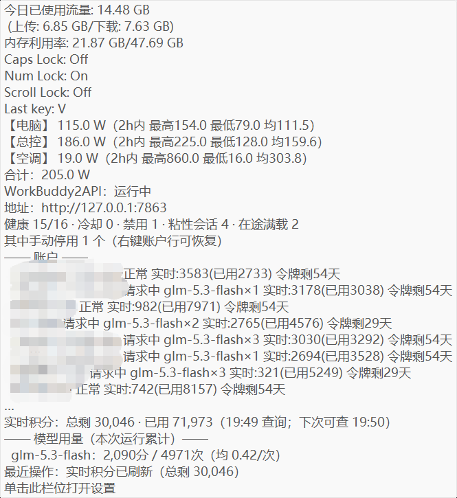
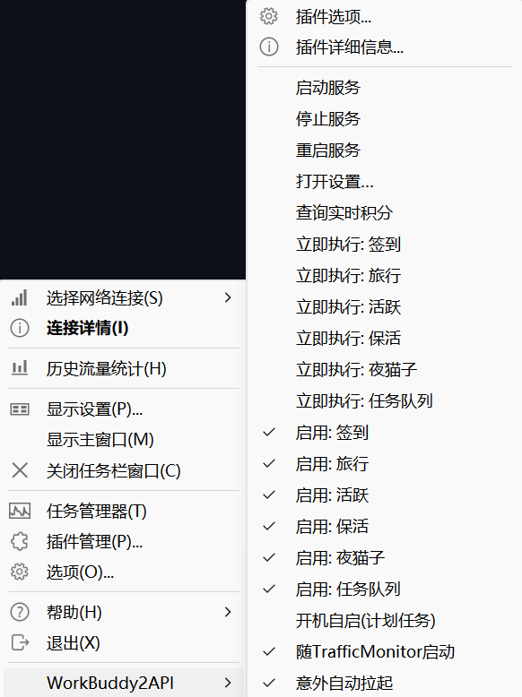
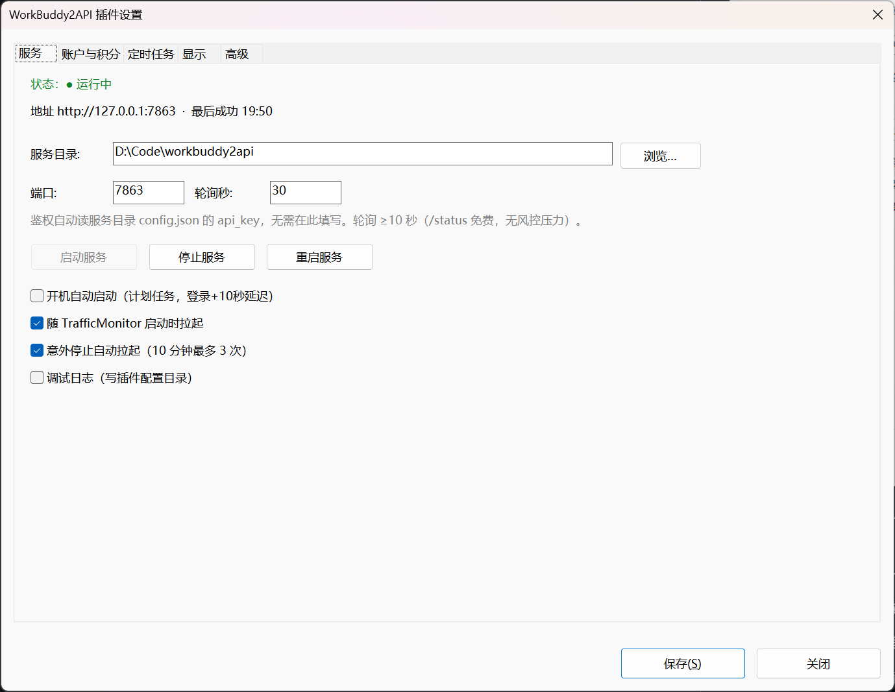
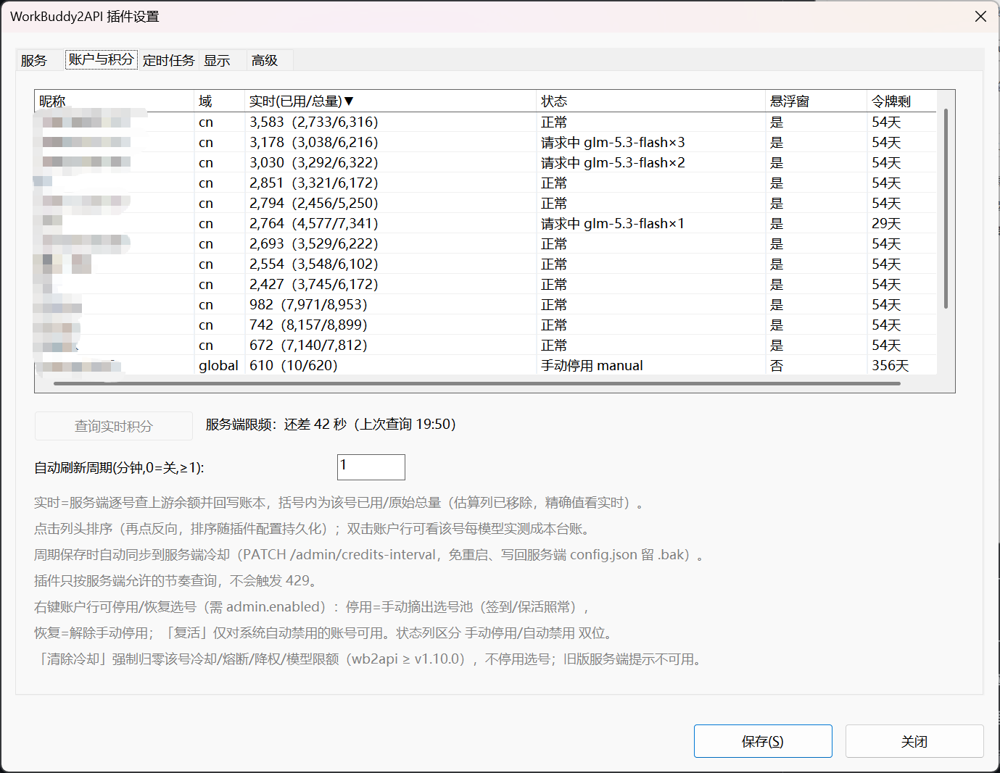
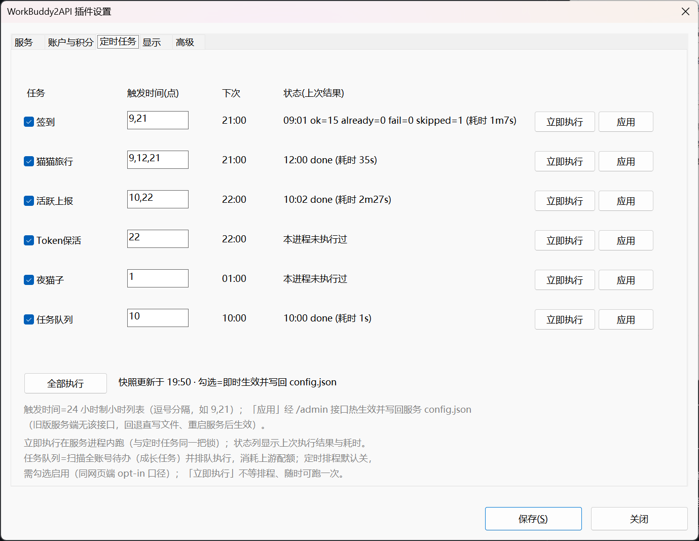
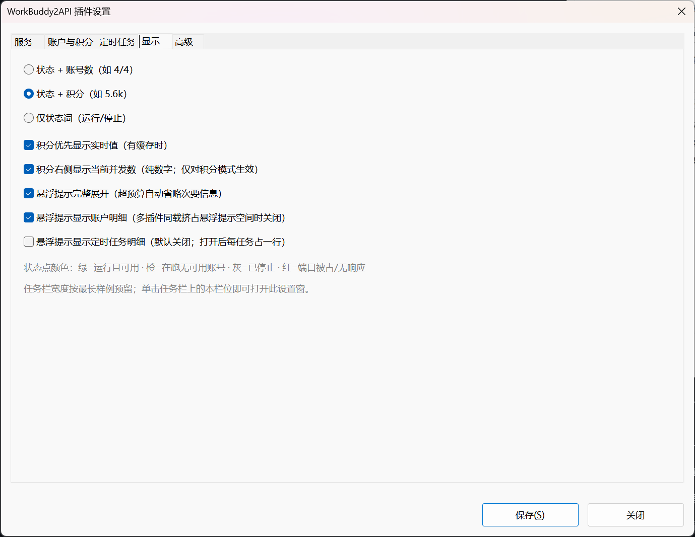
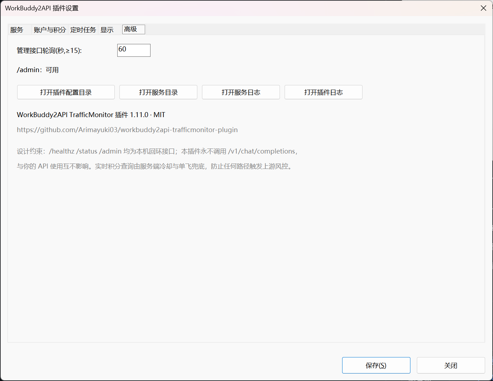

<div align="center">


# WorkBuddy2API TrafficMonitor 插件

**把 WorkBuddy2API 服务装进 TrafficMonitor 的任务栏 —— 状态、积分、任务、成本，一眼尽览**

[](https://github.com/Arimayuki03/workbuddy2api-trafficmonitor-plugin/releases)
[](https://github.com/Arimayuki03/workbuddy2api-trafficmonitor-plugin/releases)
[](https://github.com/Arimayuki03/workbuddy2api-trafficmonitor-plugin/commits/master)
[](LICENSE)
[](https://github.com/zhongyang219/TrafficMonitor)
[](https://github.com/zhongyang219/TrafficMonitor)
[](https://github.com/zhongyang219/TrafficMonitorPlugins)
[](https://learn.microsoft.com/cpp/windows/desktop-applications/)
[](https://github.com/Arimayuki03/workbuddy-cockpit)

</div>

---

## 这是什么

为 [TrafficMonitor](https://github.com/zhongyang219/TrafficMonitor) 制作的 [WorkBuddy Cockpit](https://github.com/Arimayuki03/workbuddy-cockpit)（workbuddy2api）服务监控插件：

- **任务栏栏位** — 彩点实时反映服务健康（绿/橙/灰/红），文本可配为 `4/4`（健康/总数）、积分合计或纯状态
- **悬浮提示** — 账户实时积分、定时任务、按模型用量、成本汇总，可分区开关控制长度
- **设置窗 5 页** — 服务启停/自启（或 Docker/远程地址）、账户与积分表（含成本台账）、8 类定时任务排程、显示、高级
- **插件命令菜单** — 启动/停止/重启、查询实时积分、立即执行任务、一键开关，右键即达

纯 Win32 实现（不依赖 MFC），静态 CRT，产物单文件 DLL；随带官方插件接口头 API v8（1.8.6 实测）与 nlohmann/json v3.11.3（均 vendored）。

> **必须配合 [Arimayuki03/workbuddy-cockpit](https://github.com/Arimayuki03/workbuddy-cockpit) 使用** —— `/admin` 管理接口（任务开关/立即执行/实时积分/积分冷却热改/账号停用恢复）是该网关独有的；官方上游 [Sliverkiss/workbuddy2api](https://github.com/Sliverkiss/workbuddy2api) 没有这些接口，插件的"定时任务/实时积分"页会提示不可用，只能看服务状态与账户估算积分。
>
> **Docker/远程模式**（v1.14.0）只对接地址，不启动本地服务。服务端 `/admin` 仍只接受 loopback：跨机直连时状态/账户可看，任务与实时积分会明确提示被拒——跨机想用全功能请用 SSH 隧道或同网络 TCP 代理（详见[快速开始](#docker远程模式)）。

## 目录

- [功能特性](#功能特性)
- [界面预览](#界面预览)
- [快速开始](#快速开始)
  - [前置条件](#前置条件)
  - [Docker/远程模式](#docker远程模式)
  - [从 Release 安装](#从-release-安装)
  - [从源码编译](#从源码编译)
  - [部署到 TrafficMonitor](#部署到-trafficmonitor)
- [使用指南](#使用指南)
- [服务端版本兼容](#服务端版本兼容)
- [状态点含义](#状态点含义)
- [风控防护（三层）](#风控防护三层)
- [已知边界](#已知边界)
- [故障排查](#故障排查)
- [版本历史](#版本历史)
- [许可](#许可)

## 功能特性

### 🚦 服务状态与栏位

- 彩点 = 服务状态（详见[状态点含义](#状态点含义)）；栏位文本三种模式：`4/4`（健康/总数）、积分合计、纯状态；积分模式可追加**当前并发数**（v1.12.0：纯数字缀在积分右侧，如 `5.6k 2`，设置④显示页开关）
- 主窗口与任务栏窗口的显示项独立勾选，插件命令菜单随栏位右键出现

### 👥 账户与积分

- **账户表**：实时积分（剩余（已用/总量））/ 状态（冷却 · 熔断 · 降权(连败) · 模型限额）/ 令牌剩（v1.10.1 起估算列移除，估算积分仍在悬浮提示与服务端账本中）；**点击列头排序**（同列再点反向，▲/▼ 指示当前排序列，排序随插件配置持久化、重启保留）；双击行弹出该号**每模型实测成本台账**（每1k=实测千 token 均价，≤0 即免费，口径同 wb2api 的 `status-report.ps1`）
- **实时积分**：经服务端 `POST /admin/credits` 查询，贴服务端冷却节奏；自动刷新周期保存时热写回服务端
- **账号停用/恢复**：右键账户行——「停用」把该号手动摘出选号池（签到/保活/排程照常，纯对话流量摘除）；「恢复」解除手动停用；「复活」解除系统自动禁用。状态列区分**手动停用 / 自动禁用**双位，停用状态服务端落盘、重启保留
- **强制清除冷却**（v1.10.0）：右键账户行——「清除冷却」把该号冷却/熔断/连败降权/6004 模型级限流表一键归零（不碰手动停用/自动禁用两位），上游若真仍限流会在下一次请求重新学习；需 wb2api ≥ v1.10.0，旧版提示不可用

### ⏰ 定时任务

- 8 类任务独立排程（v1.8.0 起含**任务队列**行，对齐网页端任务中心的"执行队列定时排程"；v1.11.0 起开学季行随服务端下架移除；v1.13.0 起含**令牌续期**行，对齐 wb2api v1.16.0 第 8 类 `renew` 任务，默认关；v1.14.0 起含**活动补偿**行，对齐 wb2api v1.19.2 第 9 类 `compensation` 任务，默认关）；勾选=热生效，触发时间可直接编辑并「应用」——写回走服务端 `/admin/tasks` 接口，**免重启热生效**（服务端调度器即时重排定时器）并最小 diff 落盘 config.json（留 .bak）；旧版服务端无该接口时回退直写文件，需重启服务生效
- **活动补偿**的小时表**留空（或填 `-`）= 仅手动执行**——这是服务端 v1.19.2 起的合法语义，不会被回落成默认整点；其它任务仍要求至少一个小时，空表按误用提示
- 「立即执行」= 服务进程内触发，不等排程；任务队列/活动补偿默认关（对全账号执行真实任务动作链、消耗上游配额，同网页端 opt-in 口径）

### 📊 用量可观测

- **在途/限流模型指名道姓**：账户有在途请求时状态列与 tooltip 显示"请求中 glm-4.6×2"；模型级限流直接列模型名（"模型限额 glm-4.6、glm-4.5(至 14:00)"）；任务栏积分模式可追加全账号在途合计（v1.12.0，纯数字开关）
- **模型锁池**（v1.13.0，需 wb2api ≥ v1.16.0）：tooltip 显示全池口径的模型可用性——某 (域,模型) 被全部账号的模型级冷却锁死（"全锁"，带最早解锁时刻）或因账号级原因暂时无号可服务（"全饿"，带可用/总数）；仍有号可服务的 partial 态省略，单号视角看账户行的"模型限额"
- **积分保底**（v1.13.0，需 wb2api ≥ v1.16.0）：tooltip 健康概要显示服务端 `credit_floor`（开启时）；低于保底线的账号不接收费模型
- **账号备注与续期观测**（v1.13.0）：tooltip 账户行缀服务端**备注**原文（wb2api ≥ v1.17.0，面板账号页维护、state.json 持久化）；Token 续期失败过的号缀「续期失败」标记（wb2api ≥ v1.16.0，成功续期后自动消失）
- **域可服务性**（v1.14.0，需 wb2api ≥ v1.16.0）：`/healthz` 的 `realm_servable` 显示 cn/global 各自是否还有号可服务；只在某域不可用时占一行，双域正常时省略
- **成本探索**（v1.14.0，需 wb2api ≥ v1.19.x）：tooltip 健康概要显示 `cost_explore` 累计探索次数与最近一次探索的 (域|模型) —— 解释"为什么最近总在换号/试某个模型"
- **会话吊销识别**（v1.14.0）：上游 401 网关鉴权页导致服务端自动禁用时，账户行显示「已禁用(会话失效,需重登)」而不是笼统的「已禁用」
- **按模型用量统计**：tooltip"模型用量"区列出每个模型本次服务运行累计消耗的积分与请求数，每行缀上游积分倍率（如"（x0.06）"，目录未下发时整体省略）
- **悬浮窗账户只显实时积分**（v1.9.0）：估算随轮询单调扣减、长期偏差大，小字号悬浮窗宁可少也不误导；实时缓存缺失时该行不显示积分数，需要精确值去设置窗账户表

### 🖥️ 服务管理

- 启动/停止/重启/自启/意外拉起兜底；"停止服务"只动**路径与设置一致**的 `wb2api.exe`，端口被别的程序占用时明确报错而不误杀
- **Docker/远程模式**（v1.14.0）：设置页①勾选后插件只对接「服务地址 + 手动 API Key」，**不启动/停止任何本地进程**，也不读本机 config.json；可选填宿主机映射的 `auths` 目录显示令牌到期。适合容器部署、NAS/另一台机器上的网关

## 界面预览

<details open>
<summary><b>任务栏栏位</b> —— 彩点=服务状态，文本可配为 <code>4/4</code>/积分/纯状态（下图为"状态+积分"，并开启积分右侧的并发数）</summary>


</details>

<details open>
<summary><b>悬浮提示</b>（完整展开模式）—— 状态、健康概要、账户（实时积分/请求中模型/令牌剩）、积分汇总、模型用量</summary>



</details>

<details open>
<summary><b>插件命令菜单</b>（右键栏位/托盘菜单内）</summary>



</details>

<details>
<summary><b>设置窗 · ①服务</b> —— 目录/端口/启停/自启/意外拉起</summary>



</details>

<details>
<summary><b>设置窗 · ②账户与积分</b> —— 实时（已用/总量）/状态（冷却·熔断·降权·模型限额）/令牌剩；点击列头排序，双击行看成本台账</summary>



</details>

<details>
<summary><b>设置窗 · ③定时任务</b> —— 勾选=热生效；触发时间可编辑并「应用」写回；立即执行/全部执行</summary>



</details>

<details>
<summary><b>设置窗 · ④显示</b> —— 栏位文本模式（积分可追加并发数）与悬浮提示开关</summary>



</details>

<details>
<summary><b>设置窗 · ⑤高级</b> —— 管理轮询周期、/admin 可用性、四个快捷打开</summary>



</details>

> 实拍于 v1.12.0（账户昵称已打码，无敏感信息）；v1.14.0 的服务页新增 Docker/远程模式、任务页新增活动补偿行，截图未重拍。

## 快速开始

### 前置条件

| 依赖 | 要求 |
| --- | --- |
| 宿主 | [TrafficMonitor](https://github.com/zhongyang219/TrafficMonitor)（API v8 头编译，旧版宿主可加载但部分接口静默缺失） |
| 服务端 | **[Arimayuki03/workbuddy-cockpit](https://github.com/Arimayuki03/workbuddy-cockpit)**（v1.2.0 起由 workbuddy2api fork 更名独立演进，网关侧接口契约完全兼容） |
| 服务端开关 | `config.json` 增加 `"admin": { "enabled": true }` 后重启一次服务 |

`/admin` 管理接口（任务开关/立即执行/实时积分/积分冷却热改/账号停用恢复）是 workbuddy-cockpit 独有的；官方上游没有这些接口，插件的"定时任务/实时积分"页会提示不可用。**各插件版本所需的最低服务端版本见[服务端版本兼容](#服务端版本兼容)。**

### Docker/远程模式

适用于 wb2api 跑在 Docker 容器、NAS 或另一台机器上，Windows 这边只装 TrafficMonitor 插件的情况。设置窗①勾选 **Docker/远程部署**：

| 字段 | 说明 |
| --- | --- |
| 服务地址 | 容器映射地址，如 `http://192.168.1.10:7863`。wb2api 自身是明文 HTTP；需要 TLS 请在反向代理上终止，再填 `https://` 地址。同机 Docker Desktop 可填 `http://127.0.0.1:7863`（状态/账户可用，见下方 `/admin` 限制） |
| API Key | 服务端 `config.json` / `config/config.json` 里的 `api_key`（容器内配置不在本机，必须手填） |
| auths 目录 | 可选。宿主机 `./auths` 的本地路径（bind mount 的源目录），用于显示令牌剩余天数 |

该模式**不会启动/停止/重启本地服务**，也不读写本机 config.json；"开机自启/随 TM 拉起/意外拉起"三项自动失效。

> **令牌剩余天数（可选）**：容器模式下"令牌剩"列不是从 `/status` 取的，而是插件读 `auths_dir` 下的 `workbuddy*.json`，取 `auth.expiresAt` 计算。`auths_dir` 必须是 **Windows 能直接访问的路径**：同机 Docker 填 bind mount 的宿主机源目录；跨机只能填 SMB/NFS 映射后的 UNC 或盘符。留空、目录不存在或无 `workbuddy*.json` 时该列显示 `-`（不会显示旧值）。扫描 5 分钟一轮，改完路径最多等 5 分钟或重启 TM。`auths` 文件含 refresh token，跨机共享请用只读、限制来源的共享，不要暴露到公网。

> **安全提示**：插件会把 API Key 明文保存在 `WorkBuddy2ApiPlugin.json`（与 Service 目录下的 config.json 同性质）。该文件含管理密钥，请确认配置目录权限，不要放进公共同步盘或提交进仓库。跨主机的 `http://` 会明文传输 `Authorization: Bearer`，建议 `https://` 或 SSH 隧道；同机 loopback（`127.0.0.1`）不受此限。

> **Docker 使用任务/实时积分的限制**：服务端 `/admin` 只接受 **loopback** 来源。Docker 的端口映射会让请求在容器内表现为网桥来源（不是 `127.0.0.1`），所以**即使 Docker 跑在同一台 Windows 上、插件填 `127.0.0.1:7863`，`/admin` 仍会 403**（`/healthz`、`/status` 不受影响；除非容器使用 host 网络）。插件会明确提示"远程被拒"。`/healthz`、`/status` 本身支持远程直连（带 API Key），不建隧道也能看状态、账户、积分估算、模型锁池和备注，只是任务页与实时积分按钮不可用。
>
> 跨机使用任务/实时积分的共同前提：**让服务端看到的来源是 `127.0.0.1`**。三种做法：
>
> **① SSH 隧道**（有 SSH 时最省事）
>
> ```powershell
> ssh -N -L 17863:127.0.0.1:7863 user@docker-host
> ```
>
> 插件填 `http://127.0.0.1:17863`。隧道随 SSH 会话存在，适合单机临时使用。
>
> **② 同网络命名空间的 TCP 代理**（没有 SSH，或想让局域网/Tailscale 多台设备共用）
>
> 代理必须和 wb2api **共享网络命名空间**，这样它连 `127.0.0.1:7863` 才是容器回环：
>
> ```sh
> docker run -d --name wb2api-admin-proxy --restart unless-stopped \
>   --network container:workbuddy2api \
>   alpine/socat TCP-LISTEN:17863,fork,reuseaddr TCP:127.0.0.1:7863
> ```
>
> 给 wb2api 容器补 `-p 17863:17863`（共享命名空间后端口由 wb2api 容器发布，需重建该容器）。插件和其它设备都填 `http://<docker-host>:17863`。
>
> **③ 容器内转发**：`docker exec` 进容器装 socat，直接在容器里监听 `17863`，同样把 `17863` 映射出来。镜像重建后需重做。
>
> 若容器本身用 `--network host`（OpenWrt/旁路由常见），代理直接跑在宿主机即可，无需 sidecar：
>
> ```sh
> socat TCP-LISTEN:17863,fork,reuseaddr TCP:127.0.0.1:7863
> ```
>
> **安全边界**：代理端口一旦暴露到局域网/Tailscale，就等于把 `/admin` 开放给这些网络（API Key 仍会校验，但不再是本机独享）。请用防火墙限制来源，例如只放行 Tailscale 的 `100.64.0.0/10`；不要映射到公网。
>
> **服务端挂载建议**：把 `config.json` 所在的**目录**整体挂载（`-v /opt/wb2api/config:/app/config`），不要只挂单个 `config.json` 文件——服务端保存配置走"临时文件 + rename"，单文件 bind mount 会报 `device or resource busy`；`auths`、`data` 同样建议目录挂载。

### 从 Release 安装

1. 到 [Releases](https://github.com/Arimayuki03/workbuddy2api-trafficmonitor-plugin/releases) 下载最新版附件 `WorkBuddy2ApiPlugin.dll`
2. 放入 TrafficMonitor 目录下的 `plugins\` 子目录（没有就新建）
3. 重启 TrafficMonitor，「插件管理」列表出现 **WorkBuddy2API** 即成功
4. 在「显示项目」里勾选 `WB2API 服务状态`（主窗口与任务栏窗口各有独立勾选）

### 从源码编译

需 VS2022（含 C++ 桌面工作负载或 BuildTools）：

```powershell
git clone https://github.com/Arimayuki03/workbuddy2api-trafficmonitor-plugin.git
cd workbuddy2api-trafficmonitor-plugin
powershell -ExecutionPolicy Bypass -File build\build.ps1
```

输出 `build\out\Release\WorkBuddy2ApiPlugin.dll`。

### 部署到 TrafficMonitor

```powershell
powershell -ExecutionPolicy Bypass -File scripts\deploy.ps1 -TMDir 'C:\Tools\TrafficMonitor'
```

部署脚本做"改名式替换"（旧 DLL 先改名挪走再拷入新文件），TrafficMonitor 运行中也能落位新 DLL。**但更新插件后必须重启 TrafficMonitor**——「插件管理→重新加载」不会真正加载新代码：worker 轮询线程持有模块引用把已加载的 DLL 钉在进程里，重载后跑的仍是旧实例（不报错不崩溃），只有重启宿主才生效。

## 使用指南

- **任务栏/主窗口**：彩点=服务状态，文本可配置为 `4/4`（健康/总数）、积分（可追加当前并发数纯数字）或纯状态；单击栏位打开设置。
- **设置（5 页）**：服务（本地目录/端口/启停/自启，或 **Docker/远程地址 + API Key**）、账户与积分（实时列含"剩余（已用/总量）"；状态列区分 冷却/熔断/降权(连败)/模型限额；**双击账户行**弹出该号每模型实测成本台账；**"悬浮窗"列**实时反映该号是否出现在悬浮提示明细里，与右键菜单的"悬浮提示显示此账户"同一份开关）、定时任务（勾选=热生效；触发时间可直接编辑并「应用」——经服务端 `/admin/tasks` 接口**热生效**并写回 config.json，旧版服务端回退直写文件、重启服务后生效；立即执行=服务进程内触发；**任务队列/活动补偿**行见下文）、显示（积分模式可追加当前并发数开关）、高级。
- **插件命令菜单**：启动/停止/重启、查询实时积分、立即执行/启用各类任务（含任务队列/令牌续期/活动补偿）、三个开关（Docker/远程模式下本地启停与自启命令会提示不适用）。
- **任务队列**（需服务端 ≥ 2026-09-21 合并版，`admin.enabled`）：对齐网页端任务中心的"执行队列"——扫描全部账号的待办（成长任务）并按账号排队执行。**定时排程默认关**，勾选即热启用并写回 `schedule.queue_enabled`；触发时间默认 10 点（`queue_hours`），可编辑并「应用」写回；「立即执行」不等排程、随时可手动跑一次（撞车 409 提示，与网页端互斥语义一致）。
- **活动补偿**（需 wb2api ≥ v1.19.2）：对齐面板任务页的「每日领补偿」——逐号查询并领取平台活动补偿（国际版账号跳过，已领/无可领不会重复）。**默认关**；小时表**留空或填 `-` = 仅手动执行**（页③"下次"列显示「仅手动」），需要每天自动领再填整点。任务结果回报尝试/领到账号数与总积分。
- **成本台账**：设置窗页②**双击账户行**，弹出该号每模型实测成本（模型｜每1k均价｜样本｜末次观测）。每1k=实测千 token 均价（EMA，≤0 即实测免费），6 小时无观测服务端自动回收；服务端选号按便宜优先，台账解释"为什么总选它"。
- **账号停用/恢复/复活**：页②**右键账户行**——详见上文[功能特性](#功能特性)。停用是独立状态位，与签到解冻、冷却到期等自动复活路径互不干扰。
- **tooltip 控制**：完整展开默认开，硬预算 700 字符（超预算从尾部按区整行舍弃，骨架行必留）；"显示"页可关"定时任务明细"（默认关）/“账户明细”；单账户显隐在页②右键账户行控制。详细预算规则见[已知边界](#已知边界)。

## 服务端版本兼容

插件按需使用服务端新能力，旧版服务端只是对应功能降级或提示不可用，不影响其他功能：

| 插件版本 | 功能 | 最低服务端版本 | 缺失时表现 |
| --- | --- | --- | --- |
| ≥ v1.4.0 | 账号停用/恢复/复活 | **2026-09-20 合并版**（上游 `a20d06f` 临时停用端点 + `/status` 的 `manual_disabled` 双位状态） | 提示不可用 |
| ≥ v1.5.0 | 在途模型 / 模型用量 | **2026-09-20 fork 版**（`in_flight_by_model` 台账 + `GET /v1/stats` 按模型用量聚合） | 降级为纯数量/不可用展示 |
| ≥ v1.7.0 | 模型用量倍率 | **2026-09-19 上游版**（`/v1/stats` 每模型透出积分倍率 `credits`，上游 5009a1f） | 不显示倍率，其余照常 |
| ≥ v1.8.0 | 任务队列定时排程 | **2026-09-21 合并版**（调度器第 7 类 `queue` 任务） | 该行不出现 |
| ≥ v1.9.3 | 触发时间热改 | **2026-09-23 fork 版**（`PATCH /admin/tasks` 支持 `{kind, hours}` + 面板保存配置热应用 `schedule.*_hours`，调度器 `SetHours` 即时重排） | 回退直写 config.json，需重启服务生效 |
| ≥ v1.10.0 | 强制清除冷却 | **2026-09-24 fork 版**（panel 域 `POST /api/accounts/{uid}/clear-cooldown`，冷却/熔断/连败降权/6004 模型级限流表一键归零） | 菜单置灰项点了提示不可用 |
| ≥ v1.11.0 | 开学季下架对齐 | **v1.15.0（2026-09-29）**（开学季活动 2026-09-24 结束下架：调度器到点只记说明、任务队列不再扫开学季；`school` 枚举位保留兼容老 config） | 页③/菜单不再出现开学季项，旧版服务端不受影响 |
| ≥ v1.12.0 | 任务栏并发数 | 无（纯插件功能，数据来自已有 `/status` 的 `in_flight` 字段） | — |
| ≥ v1.13.0 | 令牌续期任务行 | **v1.16.0（2026-10-08）**（调度器第 8 类 `renew` 任务，`schedule.renew_enabled` 缺省关） | 页③/菜单不出现该行，旧版服务端不受影响 |
| ≥ v1.13.0 | 模型锁池 / 积分保底 / 备注与续期观测 | **v1.16.0 / v1.17.0（2026-10-08）**（`/status` 顶层 `model_locks`、`credit_floor`；`accounts[]` 新增 `note`、`last_renewed`、`renew_last_error`） | tooltip 不显示对应区块，其余照常 |
| ≥ v1.14.0 | 活动补偿任务行 | **v1.19.2（2026-10-16）**（调度器第 9 类 `compensation` 任务；`PATCH /admin/tasks` 允许空小时表 = 仅手动） | 页③/菜单不出现该行，旧版服务端不受影响 |
| ≥ v1.14.0 | 域可服务 / 成本探索 | **v1.16.0 / v1.19.x**（`/healthz` 的 `realm_servable`；`/status` 顶层 `cost_explore`） | 对应 tooltip 行不显示，其余照常 |
| ≥ v1.14.0 | 会话吊销识别 | **v1.19.x 工作区版本**（上游 401 网关鉴权页 → 自动禁用，`disabled_reason` 含 `session revoked`） | 仍显示通用「已禁用」，不影响其它功能 |
| ≥ v1.14.0 | Docker/远程模式 | 无（纯插件功能；`/status` 远程可用；`/admin` 需 SSH 隧道或同机 loopback） | 跨机直连时任务/实时积分提示被 loopback 拒绝 |

> 仓库 [Arimayuki03/workbuddy2api](https://github.com/Arimayuki03/workbuddy2api) 已更名为 **[Arimayuki03/workbuddy-cockpit](https://github.com/Arimayuki03/workbuddy-cockpit)**，旧地址由 GitHub 自动重定向，本地已克隆的不需要动 remote。

## 状态点含义

| 颜色 | 含义 |
| --- | --- |
| 🟢 绿 | 运行中且至少一个账号可服务（/healthz 200） |
| 🟠 橙 | 服务在跑，但暂无可用账号（/healthz 503，如全部冷却/禁用/在途满载） |
| ⚪ 灰 | 已停止（端口无监听） |
| 🔴 红 | 异常：端口被其他程序占用 / 服务无响应 |

## 风控防护（三层）

1. 常规轮询只打 `/healthz`、`/status`、`/admin/tasks`、`/admin/credits`——全部是**本地服务内存数据，零上游调用**；
2. 实时积分只能经服务端 `POST /admin/credits`，服务端默认 **10 分钟冷却 + 单飞 + 账号间 200ms 限速**；冷却可热改：插件保存"自动刷新周期"时 `PATCH /admin/credits-interval`（60 秒–24 小时，免重启、写回服务端 config.json 留 .bak；设 0=关闭自动刷新时插件不改服务端）；
3. 插件 UI 在冷却期内禁用按钮，积分自动刷新默认关闭；开着时插件**贴服务端冷却节奏**查询（周期再密也只是到点即查，429 由服务端挡，插件不硬顶）。

## 已知边界

- 默认监控/控制 **本机回环**上的 wb2api；v1.14.0 起可切 **Docker/远程模式**对接任意地址（支持 `http://`/`https://`），但该模式**不启停本地服务进程**。
- 服务端 `/admin` 仍只接受 **loopback** 来源：跨机直连时任务开关/立即执行/实时积分会被 403（插件明确提示"远程被拒"）。需要全功能时用 SSH 隧道，或让 TCP 代理与容器**共享网络命名空间**（`--network container:<name>`；host 网络部署则代理直接跑宿主机）；`/healthz`、`/status` 可远程直连（需正确 API Key）。
- Docker/远程模式下，`auths` 目录是可选的宿主机映射路径；不填/不可读则账户表"令牌剩"列显示 `-`（插件无法读取容器内凭证文件，`/status` 也不下发到期时间）。WorkBuddy 网页面板同样不显示 token 到期日，只有"最近续期"；面板"导出账号"JSON 含 `auth.expiresAt`，但同时含 access/refresh token，查完请删除。
- 账号"停用/恢复/复活"走服务端内存操作（幂等，重复点击不报错）；停用是独立状态位，对旧版服务端会提示不可用。
- "模型用量"数据来自服务端 `GET /v1/stats` 的**进程内存聚合**：wb2api 重启即清零，插件只展示"本次运行累计"口径，无法回看历史；旧版服务端 tooltip 静默 30 分钟探测一次，其余时间跳过请求。"在途模型"台账同理是运行态（归零即删行、不落盘）。
- 插件更新后「插件管理→重新加载」**不会**加载新代码（worker 线程钉住 DLL 映像，重载静默失效），改配置/换 DLL 后请**重启 TM**；部署脚本已做改名式替换，见"部署到 TrafficMonitor"一节。
- 定时任务勾选的写回会先备份 `config.json.bak`，并只改动目标一行（未知字段/键序保留）。
- 触发时间（`schedule.*_hours`）修改经服务端 `PATCH /admin/tasks` **热生效**（2026-09 合并版起，免重启）；旧版服务端回退插件直写 config.json，需重启服务生效。`*_enabled` 开关与积分冷却（`/admin/credits-interval`）热生效不受版本影响。提交后若恰好有一轮**旧任务快照**晚于 PATCH 响应返回，插件保留"已提交未生效"标记直到快照真追上（小时表一致即了结），期间"下次触发"列也不被旧快照覆盖——不会出现输入框闪回旧值的观感。
- 小程序成长任务（minichat）刻意**不在**"定时任务"页出现：它不进 wb2api 的 taskKind 枚举、不经 `/admin/tasks` 透出，只能在 wb2api 的启动菜单里手动触发。任务队列（queue）则相反：它**是**调度器第 7 类任务（2026-09-21 合并版起），故 v1.8.0 起在"定时任务"页有独立一行，排程开关缺省 false 与服务端默认一致。
- **开学季已下架**（wb2api v1.15.0，活动期 2026-09-13~09-24）：服务端 `school` 枚举位保留（兼容老 config 与 `/admin` 热改）但到点只记"活动已结束"、任务队列不再扫开学季。插件 v1.11.0 起页③/命令菜单同步移除开学季项、tooltip 任务明细过滤该行；连着旧版服务端时看不到开学季入口只是 UI 不再提供，手动接口仍通（无副作用）。
- TM 只拒载 `GetAPIVersion() <= 0` 的插件，**没有**"声明版本与宿主版本比较"的检查。本插件按 v8 头编译，宿主版本更低的 TM 会照常加载，但其不支持的接口（如 v7 以下不调用 `OnInitialize`）静默缺失，表现为部分功能降级；遇到异常请升级 TM。
- TM 弹"遇到不适当的参数。"错误框是 MFC `CInvalidArgException`：TM 会把**所有插件**的 tooltip 文本拼成一条喂给 `CToolTipCtrl::UpdateTipText`，MFC 对超过 1024 字符的文本抛此异常——多个信息型插件（本插件 + MijiaPower 等）同载时总和越界才弹（栈回溯实测：mfc140u 内 throw，TrafficMonitor.exe 调用链）。
- v1.6.0 起本插件对自家 tooltip 上**硬预算 700 字符**（`worker.cpp` 的 `kTipBudget`）：完整展开（默认）最多舍弃最末的"模型用量"区，其余显示与未加预算时一致；超预算时从尾部按区整行舍弃（模型用量 → 积分汇总 → 定时任务 → 账户明细），骨架行（状态/地址/健康概要/提示/操作/尾注）必留并补一行"…"。`GetTooltipInfo` 出口另有 1000 字符硬截兜底。悬浮提示的额外控制（设置④"显示"页）：
  - **"悬浮提示显示定时任务明细"** 开关（`tooltip_tasks`，v1.7.0 起默认关闭）：需要盯任务下次触发时刻的再打开；关闭后健康概要等汇总行不受影响；
  - **"悬浮提示显示账户明细"** 开关（`tooltip_accounts`）：账户区是 tooltip 最大的长度来源，多插件同载挤占 1024 总额时优先关它；
  - **单账户显隐**：设置②"账户与积分"页**右键账户行**勾/去"悬浮提示显示此账户"（按 uid8 落盘到 `tip_hidden_uids`），隐藏的号不占 tooltip 行但仍计入健康/总数；v1.7.0 起账户表新增"悬浮窗"列（是/否）直观反映该开关的当前状态；
  - 关闭"完整展开"切到最省的折叠配额：每行 64 字符 / 4 行 / 总长 150 字符兜底。
  其他插件的 tooltip 长度不受本插件控制——同载超限弹框时优先检查同类信息型插件。

## 故障排查

- **栏位不显示**：先查主窗口与任务栏窗口各自的「显示项目」是否勾选 `WB2API 服务状态`——插件加载正常 ≠ 已勾选显示（落盘在 TM 目录 config.ini 的 `plugin_display_item` 列表）。
- **"定时任务/实时积分"页提示不可用**：服务端未开 `"admin": { "enabled": true }`，或用的是官方上游（无 `/admin` 接口）。
- **容器模式"令牌剩"一直是 `-`**：插件只从 `auths_dir\workbuddy*.json` 的 `auth.expiresAt` 算剩余天数，不走 `/status`；容器内 `/app/auths` 默认在 Windows 上不可见。把 `auths_dir` 指向宿主机 bind mount 源目录（同机 Docker）或 SMB/NFS 映射路径（跨机），确认目录里有 `workbuddy*.json`；留空/路径不存在/无权限都会显示 `-`。WorkBuddy 网页面板也不显示 token 到期日，只有"最近续期"；面板"导出账号"的 JSON 含 `auth.expiresAt`，但同时含 access/refresh token，查完请删除。
- **更新插件后行为没变**：「插件管理→重新加载」不生效，必须**重启 TrafficMonitor**（原因见上）。
- **TM 弹"遇到不适当的参数。"**：多个信息型插件 tooltip 总长超 1024 字符，先关本插件的"账户明细"/其他插件的 tooltip 再试；详见[已知边界](#已知边界)。
- **想看接口调用时序 / 排查宿主弹框**：设环境变量 `WB2API_TRACE=1` 后启动 TM，插件会记录接口调用时序，并把 first-chance 异常（C++ 异常含调用栈）写入追踪日志：默认 `<WB2API_TRACE_DIR>\wb2api_trace.log`（未设该变量则为 TM 当前目录），也可用 `WB2API_TRACE_PATH` 直接指定完整文件路径。普通 Release 产物即支持（运行期开关，无需专用构建），未开启时零开销。
- **v1.10.3 代码审查修复**（并入 v1.10.2 之后、v1.11.0 之前的连续修复）：对 v1.8.0..v1.10.2 全部变更做了一轮委托式审查（21 项发现，0 critical/high，4 medium 全修）——触发时间热生效的"旧快照回冲"残留窗口已堵（PATCH 200 后保留 pending 标记直到快照真追上，next_fire 乐观值不再被旧轮询覆盖）、动作线程卸载竞态补全（`RequestSetTaskHours` 与直写文件路径补 stop_ 检查）、账户表右键操作打错账号的防御性修复（行号→uid8 映射改为插入成功才记账）、配置并发落盘不再互撞（临时名带线程 id）、实时积分 200 但响应非 JSON 时不再清空良好缓存。
- **v1.11.0 账户表滚动残影修复**：账户行数超过可视高度、滚动列表后，表头下方出现一条多余的深色横线悬在数据区里（随滚动反复出现）。根因：ListView 竖向滚动用位块搬移复用旧帧像素，而表头下沿那条深色分隔线是每帧绘制后补画的——滚动后它随旧内容被整体搬到表头下方。修法与列宽拖动残影同型：子类过程在 WM_PAINT 里检测可视顶行号变化，变了即整帧重绘，线只出现在表头下沿本来的位置。
- **v1.11.0 菜单命令分区常量化**：开学季下架后菜单 22→20 项，所有命令分区基址改由数组长度派生（`kCmdRunBase`/`kCmdEnableBase`/`kCmdSettingBase` + `static_assert` 锁总数）——v1.10.2 修过的"开关偏移人肉同步漏改"回归从根上消除，增删任务类命令只需改一处数组，改错过不了编译。
- **v1.12.0 任务栏并发数**：积分模式可追加当前并发数（设置④"显示"页开关，默认关）——`/status` 各账号 `in_flight` 求和，纯数字缀在积分右侧（如 `5.6k 2`），打开设置即可一眼看到"现在有几个请求正在跑"。宽度预留样例同步覆盖并发位数，数字变化不引起任务栏宽度抖动；服务未跑或 `/status` 未就绪时不显示数字（不把"未知"误显为 0）。

## 版本历史

完整变更见 [Releases](https://github.com/Arimayuki03/workbuddy2api-trafficmonitor-plugin/releases)。

| 版本 | 要点 |
| --- | --- |
| v1.14.0 | **Docker/远程部署模式**：自定义服务地址 + 手动 API Key，不启停本地进程、可选 auths 映射目录；对齐 wb2api v1.19.x：新增**活动补偿**任务行（空小时=仅手动）、tooltip 显示**域可服务性**与**成本探索**、识别 **401 会话吊销** |
| v1.13.0 | 第 7 类任务**令牌续期**（页③/菜单，wb2api ≥ v1.16.0）；悬浮提示新增**模型锁池**与**积分保底**展示（wb2api ≥ v1.16.0）；账户行显示**备注**与**续期失败**标记（wb2api ≥ v1.17.0 / v1.16.0） |
| v1.12.0 | 任务栏积分模式可追加**当前并发数**（纯数字开关，设置④）；部署文档去除本机路径示例 |
| v1.11.0 | 开学季任务随服务端下架移除（页③/菜单/tooltip 同步）；账户表滚动残影修复；菜单命令分区基址常量化 |
| v1.10.x | 账户表列头点击排序（持久化）；估算列移除；插件菜单开关偏移回归修复；一轮委托式代码审查修复（v1.10.3） |
| v1.9.0 | 悬浮窗账户只显实时积分（估算口径退役） |
| v1.8.0 | 任务队列（queue）定时排程行；触发时间编辑+「应用」热生效 |
| v1.7.0 | tooltip 定时任务明细默认关闭；tooltip 硬预算 700 字符 |
| v1.5.0 | 在途模型台账 / 按模型用量统计（fork 扩展对齐） |
| v1.4.0 | 账号停用/恢复/复活（手动停用位） |

## 许可

本项目基于 [MIT License](LICENSE) 开源。
